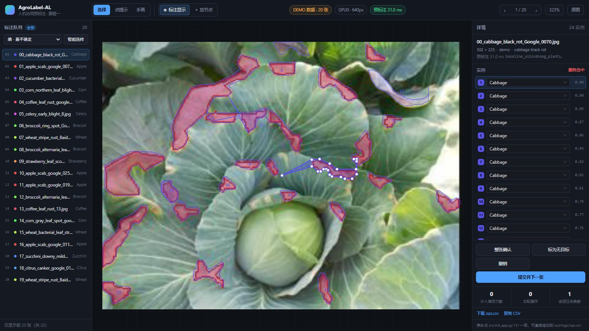

# frontend/ —— 标注工作台

React 19 + TypeScript 7 + Vite 8 + react-konva 19 + Zustand 5 + Ant Design 6。

契约见 [`../docs/INTERFACE.md`](../docs/INTERFACE.md) 与 [`../docs/INTERFACE_ADDENDUM.md`](../docs/INTERFACE_ADDENDUM.md)。



> 截图是真实渲染的：后端真模型在 302×225 的甘蓝黑腐病图上预标出 24 个病斑，
> 每个多边形都压在病斑上；右栏是实例列表与 34 类可搜索下拉。

---

## 跑起来

先起后端（另开一个终端，在仓库根目录）：

```powershell
.\.venv\Scripts\python.exe -m uvicorn backend.app:app --host 127.0.0.1 --port 8000
```

再起前端：

```powershell
cd frontend
npm install          # 首次
npm run dev          # http://localhost:5173
```

`vite.config.ts` 已把 `/api` 代理到 `127.0.0.1:8000`，所以前端代码里一律用相对路径；
生产部署时把 `dist/` 挂到反代后面即可，不用改任何 base 配置。

换后端地址：`$env:VITE_API_TARGET='http://127.0.0.1:8001'; npm run dev`

---

## 交互（与契约 §5 一一对应）

四段式：**模型预标打底 → 人做"删 / 改类" → 漏检点一下让模型放大重识别 → 手画兜底**。

| 操作 | 怎么做 | 走哪个接口 |
|---|---|---|
| 选图 | 左栏点任意一行 | `GET /api/images` + `GET /api/images/{id}/file` |
| 预标注 | 打开即自动跑 | `POST /api/predict` |
| 改类别 | 右栏实例行的下拉框（可搜索） | 纯前端 |
| 删实例 | 选中后按 `Del`，或右栏"删除选中" | 纯前端 |
| **补漏检** | 切到 **点提示** 模式后在病斑上点一下 | **`POST /api/refine`** |
| **智能选样** | 左栏选策略 + 点"智能选样" | **`POST /api/sample`** |
| 整张确认 | 右栏按钮 / `Enter` | 纯前端 |
| 标为无目标 | 右栏按钮 | 纯前端 |
| 撤销 | 右栏按钮 / `Ctrl+Z` | 纯前端 |
| 提交 | 右栏"提交并下一张" | `POST /api/annotations` |

### 智能选样的张数

左栏 `[策略] [张数] [智能选样]`。**张数默认 50**，比池子大就返回整池（按难度排好序）。

三臂实验要整池 36 张，保持默认即可 —— 之前这里写死 12，只会拿到 top-12。
### 实验臂（右栏顶部）

`预标 + 点提示` / `纯人工（无预标注）` / `预标 · 禁用点提示`。

切臂会**按新条件重新载入当前图**，产物分别落到 `out/annotations/<arm>/`：

| 臂 | 打开图时 | 点提示 |
|---|---|---|
| 预标 + 点提示 | 先读回已保存的，没有就跑 `/api/predict` | 可用 |
| 纯人工（无预标注） | 只读回已保存的，**不跑 predict**（空白开始） | 可用但没预标可点 |
| 预标 · 禁用点提示 | 同 assisted | **按钮置灰** |

> 纯人工臂同样会读回已保存的标注 —— 那一臂的产物也是产物，刷新不能丢。
> "不跑 predict"和"不读回"是两件事，别写在一起（我一开始就写错了）。

**「整张确认」「标为无目标」「提交」三个动作都会真正落盘**（都是 `POST /api/annotations`）。
之前只有"提交"落盘，"确认"只写日志 —— 标注员以为存了，刷新就全丢。

打开一张图时的顺序是：**先 `GET /api/annotations/{id}`，有保存过就恢复，没有才跑 `/api/predict`**。
所以现在**刷新不会丢数据**，恢复时会 toast 提示「已恢复上次保存的标注（N 个实例）」。

**改类、删除、拖顶点都不调后端**，只有提交才落盘 —— 这样一张图改 5 次 = 5 次本地操作 + 1 次请求，
不会把网络往返摊进 300 ms 预算（`INTERFACE_ADDENDUM.md` §5 约定 1）。

### 快捷键

| 键 | 作用 |
|---|---|
| `←` `→` | 上一张 / 下一张 |
| `Del` / `Backspace` | 删除选中实例 |
| `Enter` | 整张确认 |
| `Esc` | 取消选中 |
| `Ctrl+Z` | 撤销 |
| `F` | 自适应视图 |
| `V` | 选择模式 |
| `P` | 点提示模式 |
| `D` | 手画多边形模式 |
| `X` | 橡皮擦删节点（再按一次退出） |
| `H` | 显示 / 隐藏标注框 |
| 双击右键 | 在选中区域上插一个顶点 |

### 明暗主题（左栏底部左下角）

`☀ 白天` / `☾ 夜间` 一颗按钮切换，选择记在 `localStorage`（键 `agrolabel_theme`）。

- **默认深色**：标注员长时间盯画布，浅色底会盖过病斑对比度
- **浅色给**：白天强光、投影演示、打印截图

实现要点：
- 颜色全在 `styles.css` 的 CSS 变量里，切 `<html data-theme>` 即整站换色，
  **不触发 React 重渲染**（画布上几百个多边形不会重画）
- `index.html` 里有一段 `head` 内联脚本，在样式表加载前就把 `data-theme` 打上，
  避免浅色用户先闪一帧深色
- antd 的 `ConfigProvider` 算法（`darkAlgorithm` / `defaultAlgorithm`）跟着切，
  否则 Select 下拉会冒出一块深色浮层
- `color-scheme` 也一起设，滚动条和原生控件才会跟着变

鼠标操作速查同时显示在两处：顶栏工具行右侧（随模式变化）和右栏底部（固定图例）。

鼠标：

- **滚轮**：缩放（以光标为锚点）
- **按住中键拖拽**：平移画面（和大多数图像工具一致，任何模式下都能用）
- **左键拖拽空白处**：平移（保留的旧习惯）
- **左键双击**：自适应视图
- **左键单击多边形**：选中
- **双击右键**：在选中多边形上插一个顶点

> 中键平移是前端自己接管的：Konva 的 `dragButtons` 默认就含中键，但 Windows 上
> 浏览器会把中键 `mousedown` 当成「自动滚动」，把后续 `mousemove` 吃掉。
> 所以在容器上 `preventDefault` 挡掉默认行为，再把 Konva 的拖拽限定成 `[0]`（只认左键），
> 避免两边同时平移、动得比鼠标快一倍。

### 手画多边形（兜底路径）

顶栏「手画」模式（`D`）：**逐点单击** → **右键双击闭合**（或点回第一个点，10px 内算命中）。

| 操作 | 效果 |
|---|---|
| 空白处单击 | 落一个顶点 |
| **右键双击** / 点回起点 | 闭合；≥3 点才成实例，记 `新画` |
| 左键双击 | 只多落一个点（不会闭合，避免和加点的单击手势抢） |
| `Backspace` | 退掉最后一个顶点 |
| `Esc` | 取消当前草稿；再按一次退出手画模式 |

草稿用蓝色虚线实时画在画布上，**不受「显示标注」开关影响**——正在画就得看得见。

闭合后类别自动取**这张图的 gt 类**（人在病斑上描的是"这张图的病"，逐点选类别太慢，
要改随时在右栏下拉里改）。

### 拖顶点 / 加节点

选中实例后，它的每个顶点都可拖（`选择` 模式下的白色小圆点）。

- 边拖边更新多边形，不用等松手
- **整段拖动只压一次撤销栈** —— 否则每帧压一次，`Ctrl+Z` 要按几百下
- 松手记一条 `拖边界` 日志

顶点不够用时有三种加点方式：

| 方式 | 落点 | 适用 |
|---|---|---|
| **双击右键** | **鼠标所在位置**，插进离它最近的那条边 | 边界某处凹陷/凸起不准 |
| `＋ 加节点` 按钮 | 最长边的中点 | 整条边画得太粗，先加点再拖 |
| 手画 | 逐点单击 | 整个实例都没有 |

### 橡皮擦删节点

顶栏 **`⌫ 删节点`**（`X`）：点一下按钮，光标变成橡皮擦，**点哪个节点就擦掉哪个**。
节点会放大成粉色靶点，避免点不准。

- 少于 3 个顶点时拒绝删除并提示（两个点的"多边形"没有面积，m6 会直接丢掉）
- 删完记一条 `拖边界`，可 `Ctrl+Z` 撤销
- 再点一次按钮或按 `Esc` 退回选择模式
**双击右键**是最常用的那个（`选择` 模式）。浏览器不会给右键发 `dblclick`，所以
前端自己配对：两次右键间隔 ≤520ms、位置差 ≤10px 就算双击。新顶点落在离点击处
**最近的那条边**上（在像素空间里量点到线段距离，避免非方图被拉伸后选错边），
把这条边劈成两段 —— 也就是"离它最近的两个节点与它相连"。

> 顺带把原生右键菜单挡掉了，否则每插一个点就弹一次菜单。

`＋ 加节点` 需先选中实例，否则按钮禁用；没选就点会给 toast 提示。

> `新画` / `拖边界` 都**不计入** m5 的修改次数（`m5_logstats.py` 只统计
> `改类别` / `删实例` / `标为无目标`），但都会进 `m6_editcost.py` 的 breakdown ——
> 这也正是补这两个功能的意义：不补的话 breakdown 里恒为 0。

> **工具栏为什么在顶栏而不在画布上**：病斑面积中位数只有整图的 0.3%，
> 而画面左上角正是常有病灶的位置 —— 浮层会挡住要看的东西。
> 顶栏三列（`250px | 1fr | 318px`）与下方 `.body` 完全一致，
> 所以工具组左边缘正好压在画布左边缘（x=250）上。

### 显示 / 隐藏标注

顶栏工具栏里的 `◉ 标注显示` 开关（`H`），**默认显示**。

关掉之后多边形、序号、顶点全部从画布移除，可以干净地看原图判断病斑边界。
这是**纯视图开关**：

- 实例数据不受影响，右栏列表照常可编辑
- 关掉时多边形也不再拦截点击，此时 `选择` 模式点空白可直接取消选中，
  `点提示` 模式可以在任意位置点击
- 状态跨图保持，切图不会自己变回来

### 点提示（补漏检）

基线模型 Mask Recall 只有 0.32，一张图平均 7.2 个病斑要人补 5 个；
而病斑面积中位只占整图 0.3%，逐点描一个多边形要 22 次点击。

所以顶栏有个 **点提示** 模式（`P`）：在漏检的病斑上点一下，
前端按**图像像素坐标**调 `/api/refine`，后端裁 ROI 放大重识别，8.8~78 ms 返回多边形，
直接插入成新实例并记一条 `新画` 日志。

两条实现约定：

1. **一定要传 `class_id`**。它是硬过滤。实测不传的话，同一张甘蓝图会返回 `Wheat`（0.34）——
   放大到小 ROI 后模型丢掉了宿主上下文。前端用"当前选中实例的类 → 图像 gt 类"依次兜底。
2. **`found=false` 是正常路径**，不是错误。点healthy叶片、点背景都会返回它，
   此时提示"这个位置没认出来，请改用手画"，走手画兜底。

### 智能选样

左栏选策略 → 点"智能选样" → `/api/sample` 返回 id 列表 → 再 `GET /api/images?ids=`
取元信息 → 整队换成这批被选中的图，标题变成「选样 · entropy」。

后端默认剔除**已标注过**的图（扫 `out/annotations/*/*.txt`），所以反复点不会一直推荐同一批。

> `reasons.score` 恒为 `null`：模型侧 `select()` 只返回路径不返回分值。
> `rank` 是选样顺序，可以用来展示"优先标哪个"。

---

## 操作日志

右侧底部两个按钮：

- **下载 ops.csv** —— 生成 `ts,image,op,instance,detail,n_ops_on_image,api_ms` 表头的 CSV
- **复制 CSV** —— 同上，进剪贴板

表头与 `src/m4_app.py:131` **逐字一致**，`src/m5_logstats.py` 可直接 `csv.DictReader` 读。
`op` 词表严格限定在 `改类别` / `删实例` / `标为无目标` / `整张确认` / `撤销` / `提交` / `新画` / `拖边界`。

### 自动上送

日志**同时**走两条路：

1. **实时上送**：每攒够 5 条、或停手 0.8 秒，就 `POST /api/logs/ops`，由后端追加进
   `out/logs/ops.csv`。这样 `src/m5_logstats.py` 随时能算出真实数字。
2. **本地兜底**：内存里的 `ops` 数组始终完整，后面两个按钮随时可导出。

上送是**不阻塞标注**的：失败就把事件留在队列里等下次，连续失败 3 次自动停用自动上报
（避免后端没起来时每个操作都打一次无效请求），此时本地 CSV 导出仍然可用。

> 提交时会**强制冲一次队列再翻页** —— `m5_logstats.py` 靠 `提交` 事件确定分母，
> 少这一条它就会报"还没有已提交的图，无法统计"。

---

## 目录

```
src/
├── main.tsx                    # 挂载 + antd 深色主题
├── App.tsx                     # 三栏布局 + 启动屏 + toast
├── api.ts                      # 带类型的 API 客户端
├── store.ts                    # Zustand：队列 / 当前图 / 实例 / 撤销 / 日志
├── types.ts                    # 与契约一一对应的类型
├── colors.ts                   # 34 类黄金角配色
├── styles.css                  # 除 antd Select 外全部手写
├── hooks/useHotkeys.ts
└── components/
    ├── TopBar.tsx              # 数据集模式 / 设备 / 时延 / 翻页 / 缩放
    ├── QueuePanel.tsx          # 左栏队列
    ├── CanvasStage.tsx         # Konva 画布：图片 + 多边形 + 顶点
    └── InspectorPanel.tsx      # 右栏实例列表 + 动作 + 统计 + 导出
```

---

## 关于参考 X-AnyLabeling

可以，而且是**应该**参考的 —— 但要分清哪些抄、哪些不抄。

**抄这三样：**

1. **数据格式**（`anylabeling/views/labeling/label_file.py` + `shape.py`）。
   `LabelFile` 的 JSON 是事实标准：
   `{version, flags, shapes[], imagePath, imageData, imageHeight, imageWidth}`，
   每个 shape 是 `{label, score, points, group_id, difficult, shape_type, flags, description, attributes, kie_linking}`。
   我们内部用归一化坐标，但**导入导出时按它的结构序列化** ——
   这样队友拿桌面版 X-AnyLabeling 人工标的数据能直接进流水线，交付时也好看。
2. **交互约定**：`Ctrl+Z` 撤销、`Del` 删除、滚轮缩放、双击自适应 —— 这是标注工具的肌肉记忆。
3. **`shape_type` 的取值**（`polygon` / `rectangle` / `point` …），别自己发明一套。

**不抄的两样：**

1. **坐标约定**。X-AnyLabeling 的 `points` 是**绝对像素**（源码里没有任何 normalize）。
   我们的契约是**归一化**（`INTERFACE_ADDENDUM.md` §2.6）。
   互转就是 `× width / ÷ width`，但**必须封成一个转换函数**；混用一次就会出现
   "多边形整体偏移一个屏幕"这种最难查的 bug。
2. **整体架构**。它是 PyQt 桌面应用（`QGraphicsScene`），我们是 React + Konva。
   把 `label_widget.py`（上万行）搬过来只会把前端拖死。

**值得后续补**（按性价比排）：

- 导入/导出 X-AnyLabeling JSON（约半天，直接换来"与桌面工具互通"这个卖点）
- 手画多边形 + 拖顶点（P1 兜底路径；`/api/refine` 落地后优先级会降）
- 撤销栈目前存整份快照，实例上千时应改成 patch

---

## 已知取舍

- **打包 827 kB（gzip 266 kB）**，大头是 antd + konva。本机跑无感；
  要压的话把 antd 换成自写的 34 项搜索下拉，估计能省 ~400 kB。
- **`npm run build` 在受限 shell 里会 `spawn EPERM`**（Vite 8 的 `windowsSafeRealPathSync` 要 exec 子进程），
  用 `vite build --configLoader native` 可绕过。正常 PowerShell 里 `npm run dev` / `npm run build` 都没问题。
